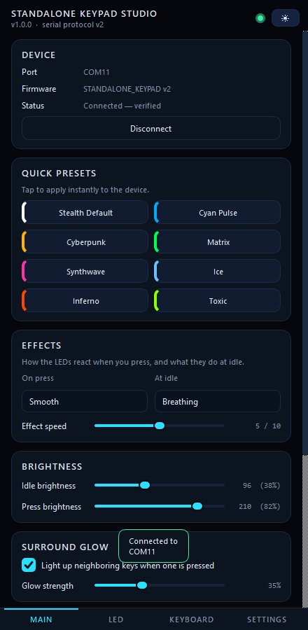
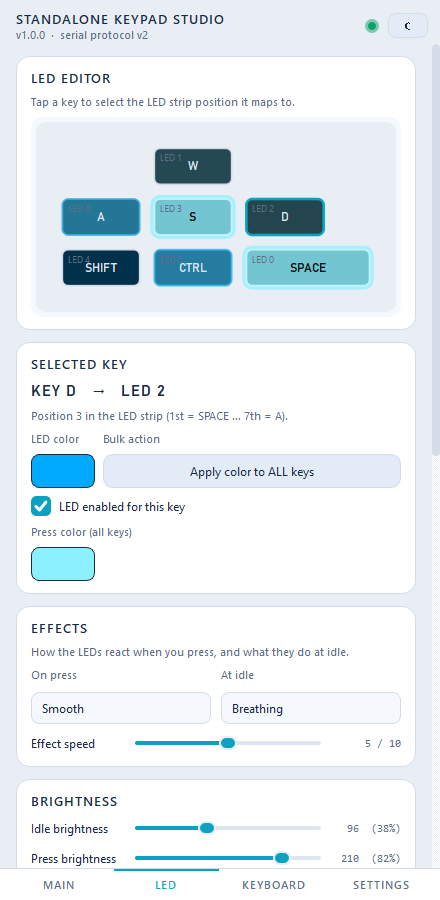

# Standalone Keypad Studio

Companion app for a custom 7-key **clicky keypad** built on an Arduino Pro Micro
(ATmega32U4) with 7 WS2812B LEDs (one per key). Configure everything live over USB
serial: LED colors, brightness, press/idle effects, surround glow, presets, and
full key remapping — everything is stored on the device in EEPROM.




## Features

- **Phone-style UI** — 4 tabs (Main / LED / Keyboard / Settings), smooth fade
  animations, dark & light theme, 85–130% interface scaling.
- **Connection screen** — auto-refreshes the USB device list, auto-detects and
  verifies the keypad when plugged in (handshake check), remembers the last port,
  and falls back safely if the connection drops.
- **LED tab** — per-key colors (or apply-to-all), per-LED enable/disable, press
  color, idle/press brightness, press effects (Instant, Smooth, Ultra Smooth,
  Bouncy), idle effects (Off, Static, Breathing, Rainbow, Wave, Sparkle),
  surround glow and 24 ready-made presets — tap to apply instantly.
- **Keyboard tab** — remap every physical key to any keyboard key/button in
  realtime (press-to-capture or pick from a list), reset individual keys.
- **Settings tab** — reset the device to defaults (with confirmation),
  theme + scale, connection info.
- **Live view** — a live render of the keypad that mirrors presses and effects.

## Repository layout

```
standalone_keypad_studio/
├─ app/                 # Python app (PySide6)
│  ├─ main.py           # entry point
│  ├─ protocol.py       # keycodes, presets, serial protocol helpers
│  ├─ serial_link.py    # pyserial worker, handshake, port listing
│  ├─ state.py          # app <-> device state hub
│  ├─ theme.py          # dark/light themes + scaling
│  ├─ connection_page.py
│  ├─ tabs/             # dashboard, LED, keyboard, settings
│  └─ widgets/          # card, pad view, sliders, toast...
├─ firmware/standalone_keypad/standalone_keypad.ino
├─ tools/               # smoke_test.ps1, screenshot.py
├─ shots/               # UI screenshots
├─ build_exe.ps1        # PyInstaller build script
└─ requirements.txt
```

## Hardware

| Part | Notes |
|------|-------|
| Arduino Pro Micro (ATmega32U4), 5V/16MHz | clones work fine |
| 7× clicky switches | any MX-style |
| 7× WS2812B LEDs | chained, one behind each key |
| 1× 330Ω resistor | LED data line |
| 1× 470µF capacitor | across LED 5V/GND (optional but recommended) |

### Wiring

Keys — one leg to **GND**, other leg to the pin (INPUT_PULLUP, no diodes needed):

| Key | Pin |
|-----|-----|
| W | D2 |
| A | D3 |
| S | D4 |
| D | D5 |
| SHIFT | D6 |
| CTRL | D7 |
| SPACE | D8 |

LEDs — data in on **D10** (through the 330Ω resistor), 5V to **VCC**, GND to GND.
Chain order (arrow = data direction, left/tail = IN, right/head = OUT):

| Chain position | 1st | 2nd | 3rd | 4th | 5th | 6th | 7th |
|----------------|-----|-----|-----|-----|-----|-----|-----|
| Key | SPACE | W | D | S | SHIFT | CTRL | A |

## Firmware

Requires `arduino-cli` with the SparkFun AVR core and two libraries:

```powershell
arduino-cli core install SparkFun:avr     # + arduino:avr dependency
arduino-cli lib install Keyboard
arduino-cli lib install "Adafruit NeoPixel"
arduino-cli compile --fqbn SparkFun:avr:promicro:cpu=16MHzatmega32U4 firmware/standalone_keypad
arduino-cli upload  --fqbn SparkFun:avr:promicro:cpu=16MHzatmega32U4 -p COM11 firmware/standalone_keypad
```

If your board is the 8MHz/3.3V variant use `cpu=8MHzatmega32U4` instead.
**Check `-p COMx` first** — never flash the wrong port.

### Serial protocol (115200 baud, line-based)

| Command | Effect |
|---------|--------|
| `PING` | replies `PONG` |
| `ID` | replies `ID:STANDALONE_KEYPAD:2` |
| `GET` | dumps full config block, ends with `END` |
| `SET LED:i:r:g:b` | set LED `i` (255 = all) to color |
| `SET ENA:i:0\|1` | enable/disable LED `i` |
| `SET PRESS:r:g:b` | press color |
| `SET BRIGHT:idle:press` | brightness values (0–255) |
| `SET FX:p:i:speed:surr:strength` | press fx 0–3, idle fx 0–5, speed 1–10, surround 0/1, strength 0–100 |
| `SET KEY:i:code` | remap key `i` (Arduino Keyboard.h keycodes) |
| `RESET` | restore defaults (saved to EEPROM) |
| `REBOOT` | watchdog reset |
| `EVT:i:0\|1` | key `i` released/pressed (sent by device) |

## Running the app

From source (Windows):

```powershell
pip install -r requirements.txt
python app/main.py
```

Standalone builds:

```powershell
.\build_exe.ps1
# -> dist\StandaloneKeypadStudio.exe          (single file)
# -> dist\StandaloneKeypadStudio_onedir\      (fast folder build)
```

App settings (saved port, theme, scale) live in
`%TEMP%\standalone_keypad_studio\settings.txt` — nothing is written into the repo.

## License

MIT
